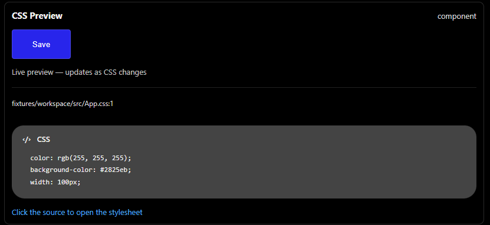

# CSS Peek Preview

CSS Peek Preview shows a visual sample and the CSS rules for the static HTML `class` or JSX `className` token under the cursor. Use **Alt+Shift+C** (customizable in Keyboard Shortcuts) or run **CSS Peek Preview: Show Preview**. The command opens a preview panel beside the editor, renders a simple sample element using a safe subset of the matched CSS, and lists the source declarations. The sample uses nearby static element text when available (for example, a `Save` button).

Keep the panel open while editing: it refreshes automatically when the matched CSS/SCSS changes, including unsaved edits in an open stylesheet. Click **Click the source to open the stylesheet** below a rule to open that CSS/SCSS file in a VS Code editor tab and select the matching class in its selector. The preview stays open beside the editor.



## Try the example gallery

The sample workspace in `test/fixtures/workspace` contains a TSX component gallery and a neighboring `App.css`, including CSS-nested rules. Place the caret on a container class such as `preview-card` to render the complete static subtree; the preview also collects styles for the nested elements and their classes. To try it during development:

1. Open this extension project in VS Code and press **F5** to launch the Extension Development Host.
2. In the host window, open `test/fixtures/workspace/src/App.tsx`.
3. Place the caret inside a class such as `component`, `secondary-button`, `status-badge`, `avatar`, or `info-tile`.
4. Run **CSS Peek Preview: Show Preview**. Change the matching rule in `App.css` and watch the open preview update.

To change the shortcut, open **File → Preferences → Keyboard Shortcuts** (on macOS: **Code → Settings → Keyboard Shortcuts**), search for **CSS Peek Preview: Show Preview**, and assign any key combination.

The preview reports matching declarations in source order. It does **not** compute browser styles, simulate layout, or determine which declaration wins in the CSS cascade. The sample is deliberately conservative and omits unsafe or unsupported values while retaining them in the CSS listing.

## Stylesheet lookup

By default, editing `src/components/Test.tsx` checks `src/components/Test.css`. The resolver tries the configured path first, followed by adjacent module and extension variants in a fixed order: the exact configured path; the same basename with `.module` before the configured extension; then each configured extension in order, first as `Test.ext` and then `Test.module.ext`. Duplicate paths are read once. It returns the rules from the first candidate that contains a match, so the configured path wins when it defines the class. No other directory is examined unless workspace search is enabled.

`cssPeekPreview.stylesheetPath` supports:

* `{directory}`: source directory relative to its containing workspace folder, using `/` separators. For a file outside a workspace it is empty.
* `{name}`: source filename without its final extension.
* `{extension}`: source extension without its leading dot.

Relative patterns are rooted at the containing workspace folder when the source is in a workspace; otherwise they are rooted at the source file's directory. Thus a pattern without `{directory}` is workspace-root-relative in a workspace. Absolute filesystem paths are used as-is. This setting resolves local `file:` source documents; non-file documents are not supported. Unknown placeholders make the pattern invalid and produce a preview message.

`cssPeekPreview.stylesheetExtensions` defaults to `[".css", ".scss"]` and controls extension variants and workspace-search file types. CSS Modules use `.module.css` and `.module.scss` names and are considered by the resolver. Include the leading dot for clarity; it is added automatically if omitted.

`cssPeekPreview.searchWorkspace` defaults to `false`. When enabled, and only after the configured candidates have no match, the extension searches up to 500 stylesheet files in the source file's workspace folder. It excludes `node_modules`, `.git`, `dist`, `build`, and `out`, and uses VS Code's default file exclusions. With the default setting, no workspace-wide search occurs.

Example settings for a component stylesheet in React:

```json
{
  "cssPeekPreview.stylesheetPath": "{directory}/{name}.css",
  "cssPeekPreview.stylesheetExtensions": [".css", ".scss"],
  "cssPeekPreview.searchWorkspace": false
}
```

For Astro projects that keep styles in a `styles` subdirectory, use:

```json
{
  "cssPeekPreview.stylesheetPath": "{directory}/styles/{name}.scss",
  "cssPeekPreview.stylesheetExtensions": [".scss", ".css"],
  "cssPeekPreview.searchWorkspace": true
}
```

## Supported source and limitations

The initial version supports statically quoted class values in HTML, JavaScript, JSX, TypeScript, TSX, Astro, Vue, and Svelte documents. It recognizes whitespace-separated names, hyphens, underscores, and simple CSS escapes. The visual sample includes the selected element's static descendants and collects rules for each descendant class, including CSS-nested selectors. Dynamic JSX expressions are omitted from the sample. Dynamic class expressions, template literals, generated class names, and class strings split across lines are not resolved. Run the command while the caret is inside a class token; other contexts receive a short explanation.

CSS and SCSS are parsed with PostCSS. Rules nested in at-rules are listed with their parent at-rule context. Selector matching uses parsed class nodes (so `.btn` does not match `.btn-large`). Partially written or inaccessible files are skipped safely.

The visual sample runs in a sandboxed webview and applies a conservative subset of CSS declarations. It does not create a browser page, compute the full CSS cascade, or reproduce layout from the surrounding application. A native hover is also available over the class token for a compact view.

## Development

```sh
npm install
npm run compile
npm test
```

Open this folder in VS Code and press F5 to launch the Extension Development Host. Tests use `@vscode/test-electron`.
